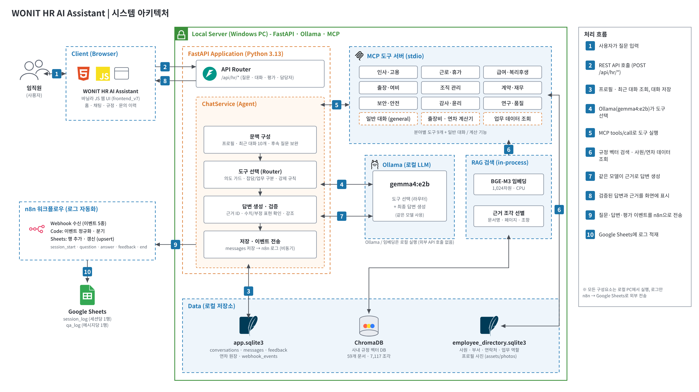

# 사내 규정 AI 업무 도우미 (WONIT HR AI Assistant)

사내 규정과 인사 정보를 자연어로 물어볼 수 있는 **로컬 AI 챗봇**입니다. 질문에 맞는 업무 도구를 AI가 골라 규정 검색, 연차·출장비 계산, 담당자 조회를 수행하고, 근거 문서와 함께 답변합니다. 모든 구성요소(AI 모델, 벡터 DB, 사원 DB)가 로컬 PC에서 실행되며, 로그만 n8n을 통해 Google Sheets로 기록됩니다. (KDT 미니 프로젝트)



## 주요 기능

- **규정 질의응답**: 9개 분야(인사·근로·급여·출장·조직·계약·보안·감사·연구)의 규정 59개 문서를 검색해 답하고, 출처(문서명·쪽)를 함께 보여줍니다. 규정 원문 PDF는 화면에서 바로 열 수 있습니다.
- **개인 맞춤 계산**: 입사일·직급을 기준으로 연차 부여일수와 잔여 연차를 계산하고, 출장 예상 여비를 계산 과정과 관련 규정까지 보여줍니다. 모든 금액은 AI가 아니라 코드가 계산합니다.
- **담당자·사원 찾기**: 답변 근거가 부족하면 관련 부서의 담당자를 사진·내선·이메일이 담긴 카드로 추천하고, 사원·부서 검색과 사원 카드(프로필 사진)를 제공합니다.
- **일반 대화**: 업무와 무관한 질문(인사, 잡담 등)은 규정 검색 없이 자연스럽게 답합니다.
- **이력·평가·로그**: 대화는 SQLite에 저장되어 이전 문의 이력을 다시 볼 수 있고, 종료할 때 만족도(1~5점)를 남깁니다. 질문·답변·평가는 n8n을 거쳐 Google Sheets에 자동 기록됩니다.
- **안전장치**: AI가 도구를 잘못 고르거나 관련 없는 데이터가 붙는 문제를 막기 위해 의도 가드, 도구 결과 검증, 근거 확인 단계를 둡니다. ([도구 호출 안전장치](my-chatbot/docs/tool-calling-safeguards.md))

## 동작 흐름

1. 사용자가 사번을 입력하고 질문합니다.
2. 서버가 사용자 프로필과 최근 대화를 조회합니다.
3. AI가 도구 목록(MCP)에서 질문에 맞는 도구를 하나 고릅니다. (잡담이면 일반 대화)
4. 도구가 규정 검색(ChromaDB), 사원·연차 데이터 조회, 계산을 수행합니다.
5. 검색된 근거와 조회·계산 결과로 AI가 답변을 만들고, 서버가 근거·수치를 확인합니다.
6. 답변과 출처를 화면에 표시하고, 대화를 저장하며 로그를 n8n으로 보냅니다.

## 기술 스택

| 영역 | 사용 기술 |
| --- | --- |
| 화면 | HTML · CSS · JavaScript (`frontend_v7`) |
| 서버 | Python 3.13 · FastAPI |
| AI 모델 | Ollama (`gemma4:e2b`, 도구 선택과 답변 생성 공용) |
| 도구 호출 | MCP (stdio) |
| 규정 검색(RAG) | ChromaDB · BAAI/bge-m3 임베딩 (59개 문서, 7,117개 조각) |
| 데이터 | SQLite (`data/app.sqlite3` 대화·평가·연차, `database/employee_directory` 사원·부서) |
| 로그 자동화 | n8n → Google Sheets |

## 실행 방법

준비물: Python 3.13, [Ollama](https://ollama.com), 그리고 사용할 모델.

```console
ollama pull gemma4:e2b
cd my-chatbot
python -m pip install -r requirements.txt
python -m scripts.init_db
python -m app --reload
```

- 화면: http://127.0.0.1:8000/
- API 문서: http://127.0.0.1:8000/docs
- 사번은 `WON` 뒤에 숫자만 입력합니다(예: `0001`). 사원 데이터는 가상의 105명, 부서 16개입니다.
- 임베딩 모델(BAAI/bge-m3)은 처음 실행할 때 내려받아 `data/models`에 저장합니다.
- 테스트: `python -m tests -v`

## 설정 (.env)

실제 값은 `.env`에 두고, 공유용 양식은 `.env.example`입니다. 자주 바꾸는 항목만 정리했습니다.

| 항목 | 설명 |
| --- | --- |
| `OLLAMA_MODEL` / `OLLAMA_ANSWER_MODEL` | 도구 선택 / 답변 생성 모델. 기본값은 둘 다 `gemma4:e2b` |
| `UI_REGULATIONS_DIR` | 사내 규정 화면의 PDF 원문 폴더 (`./data/regulations_pdf`, 59개) |
| `CHROMA_DIR` | 규정 벡터 DB 위치 (`../kdn_regulations_rag/rag_data/chroma_db`) |
| `SQLITE_PATH` | 앱 DB (`./data/app.sqlite3`) |
| `EMPLOYEE_DIRECTORY_DIR` | 사원 DB (`./database/employee_directory`) |
| `ENABLED_TOOLS` | 비우면 전체 도구 사용, 쉼표로 ID를 적으면 일부만 사용 |
| `N8N_WEBHOOK_URL` | 로그를 보낼 n8n 주소. 비우면 전송하지 않으며 대화는 정상 동작 |
| `N8N_ASYNC` | 기본 `true`. 로그를 백그라운드로 보내 답변 속도에 영향이 없음 |

n8n으로 보내는 이벤트는 `session_start`, `question`, `answer`, `feedback`(만족도와 함께 종료), `end`(만족도 없이 종료) 5가지이며 이름은 `N8N_EVENT_*` 항목으로 바꿀 수 있습니다. 자세한 내용은 [my-chatbot/docs/end-webhook.md](my-chatbot/docs/end-webhook.md)를 참고하세요.

서로 다른 모델 두 개를 쓰는 경우에는 Ollama 서버의 `OLLAMA_MAX_LOADED_MODELS=2` 설정이 필요합니다. 같은 모델을 쓰면 필요 없습니다.

## 폴더 구조

프로젝트 전체(작업 폴더)는 아래와 같습니다. 챗봇 실행과 개발은 `my-chatbot`에서 합니다.

| 폴더 | 설명 |
| --- | --- |
| `my-chatbot` | 챗봇 본체 (서버, 화면, DB, 문서) |
| `kdn_regulations_rag` | 규정 PDF를 파싱·임베딩해 ChromaDB에 적재하는 도구와 결과. 챗봇이 검색에 쓰는 규정 DB가 여기 있습니다 |
| `data` | 사원·연차 원본 데이터셋과 Google Sheets 양식 (최초 데이터 적재용) |
| `employee_tools_project` | 연차·출장비 계산 도구의 원본 프로젝트 (코드는 `my-chatbot/app/vendor`에 반영됨) |

`my-chatbot` 안의 구성입니다.

| 위치 | 역할 |
| --- | --- |
| `app/agent` | 대화 처리, 도구 선택, 답변 생성 |
| `app/tools` · `app/mcp` | 분야별 도구와 MCP 서버·클라이언트 |
| `app/rag` | 임베딩과 ChromaDB 검색 |
| `app/repositories` | 대화·사원 데이터 접근 |
| `app/vendor` | 연차·출장비 계산 도구 코드 |
| `frontend_v7` | 현재 화면 (이전 화면은 `frontend`에 보존) |
| `database` · `data` | 사원 DB, 앱 DB, 규정 PDF, 평가 데이터 |
| `prompts` · `config` | 답변·분류 프롬프트, 담당자·여비 등급 설정 |
| `scripts` | DB 준비, 데이터 적재, 평가, ERD·명세 생성 |
| `docs` | 설계·설정·검증 문서 |
| `tests` | 테스트 |

## 더 알아보기

- [시스템 구성도 설명](my-chatbot/docs/architecture/README.md) · [DB 구조(ERD)](my-chatbot/docs/erd)
- [계산기(연차·출장비)](my-chatbot/docs/calculators.md) · [도구 호출 안전장치](my-chatbot/docs/tool-calling-safeguards.md)
- [RAG 구성](my-chatbot/docs/rag-sqlite.md) · [MCP](my-chatbot/docs/mcp.md) · [답변 품질 기준](my-chatbot/docs/answer-quality.md)
- [담당자 추천](my-chatbot/docs/contact-escalation.md) · [사원 데이터](my-chatbot/docs/employee-directory-integration.md)
- [발표 시나리오 검증 기록](my-chatbot/docs/presentation-scenario-validation.md)
