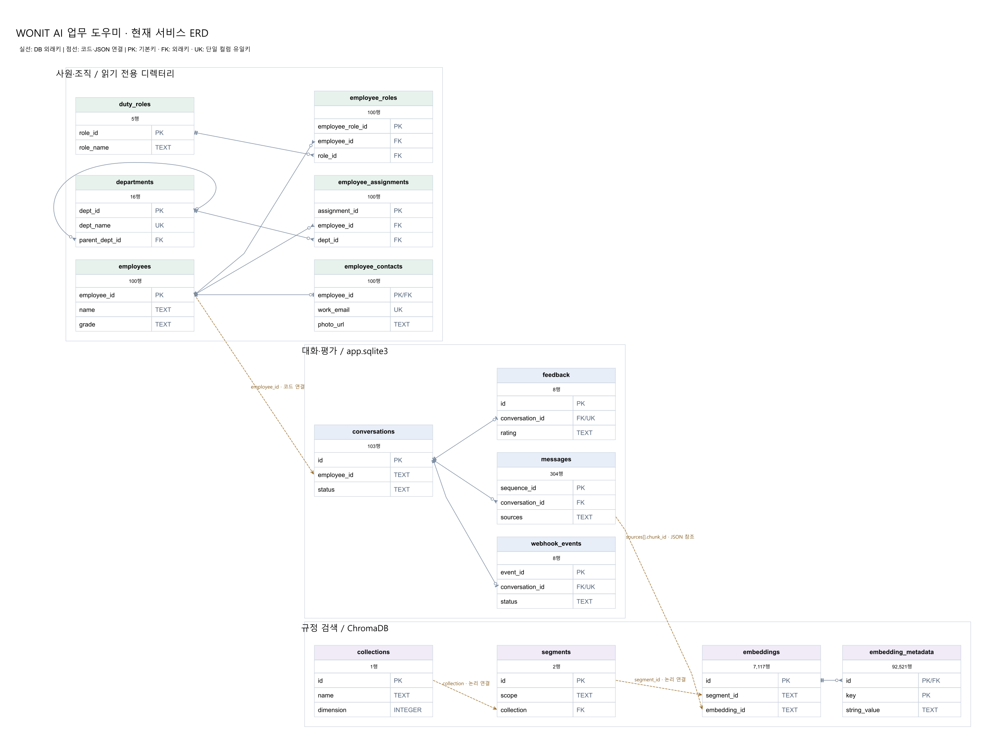

# 프로젝트 전체 DB ERD

조사 기준: 2026-11-05. 실제 SQLite 파일은 읽기 전용으로 열고 테이블·키·뷰·건수만 확인했습니다.
아래 행 수는 조사 시점의 스냅샷입니다. 대화 본문·직원 연락처의 실제 값은 이 문서에 포함하지 않습니다.

## 현재 서비스 전체 관계



[확대 가능한 SVG](service-overview.svg) · [전체 컬럼 사전](data-dictionary.md) · [구조 조사 JSON](schema-inventory.json)

- 실선: 실제 DB에 선언된 외래키. 끝의 원/갈퀴는 0건 허용 및 다건 관계를 나타냅니다.
- 점선: 코드나 JSON으로 연결하는 논리 관계. DB가 강제하는 외래키가 아닙니다.
- PK: 기본키, FK: 외래키, UK: 단일 컬럼 유일키. 복합키는 컬럼 사전에 별도로 표시합니다.
- 전체도는 현재 사용 중인 사원 6개·대화 4개·Chroma 핵심 4개 테이블의 주요 컬럼만 보여줍니다.
  모든 컬럼과 보관용·미사용 테이블은 아래 상세 ERD에 포함했습니다.

## 실제 DB와 설정

| 구분 | 파일 / 설정 | 구조 | 조사 결과 |
| --- | --- | --- | --- |
| 사원·조직·연락처 | database/employee_directory/employee_directory.sqlite3 / EMPLOYEE_DIRECTORY_DB | 6개 테이블 + 1개 뷰 | 사원 100명, 부서 16개 |
| 대화·평가 | data/app.sqlite3 / SQLITE_PATH | 12개 테이블 + 1개 뷰 | 대화 103건, 메시지 304개, 평가 8건, 종료 웹훅 8건 |
| 규정 검색 | ../kdn_regulations_rag/rag_data/chroma_db/chroma.sqlite3 / CHROMA_DIR | 엔진 내부 21개 테이블 | 문서 59개, 조각 7,117개, 메타데이터 92,521행 |
| 과거 색인 사본 | my-chatbot/chroma_db/chroma.sqlite3 | 엔진 내부 21개 테이블 | 현재 CHROMA_DIR에서 선택되지 않음 |
| Tool 배포본 색인 | ../employee_tools_project/data/rag_data/chroma_db/chroma.sqlite3 | 엔진 내부 21개 테이블 | 현재 앱의 CHROMA_DIR에서 선택되지 않음 |
| 원본 전사 데이터셋 | ../data/KDN_Enterprise_AI_Dataset/KDN_Enterprise_AI_Dataset_Pexels/sql/01_create_schema.sql | 43개 테이블 + 3개 뷰 | 원본 DDL 기준. 현재 서비스에 43개가 모두 연결된 것은 아님 |
| 제공 Tool의 예시 DB | ../employee_tools_project/employee_tools/schema.example.sql | 5개 테이블 정의 | 실제 employee.sqlite3 파일은 확인되지 않음 |

현재 설정은 `STORAGE_BACKEND=sqlite`, `USER_DATA_SOURCE=directory`입니다.
MySQL용 schema.sql은 호환용 구조 정의로 확인했으며 MySQL 서버에 접속한 조사 결과는 아닙니다.
사진 바이너리는 DB에 저장하지 않고 경로·URL·출처·검수 상태를 employee_contacts에 저장합니다.

## 1. 사원·조직·연락처 DB

[전체 컬럼 ERD / SVG](directory.svg) · [Mermaid 원본](directory-full.mmd)

| 부모 → 자식 | 관계 | 연결 키 |
| --- | --- | --- |
| departments → departments | 상위 부서 0..1 : 하위 부서 0..N | parent_dept_id → dept_id |
| employees → employee_assignments | 1 : 0..N | employee_id |
| departments → employee_assignments | 1 : 0..N | dept_id |
| employees → employee_contacts | 1 : 0..1 | employee_id (PK + FK) |
| employees → employee_roles | 1 : 0..N | employee_id |
| duty_roles → employee_roles | 1 : 0..N | role_id |

`v_employee_profiles`는 employees + 유효한 주 소속 employee_assignments + departments + employee_contacts를 합친 조회 뷰입니다.
직원별 업무 역할은 employee_roles와 duty_roles에서 별도로 조회해 프로필에 합칩니다.
부서와 업무 역할의 다대다 관계를 사원 소속/역할 배정 테이블이 표현합니다.

## 2. 앱 대화 DB

[12개 테이블 전체 ERD / SVG](app.svg) · [Mermaid 원본](app-full.mmd)

| 테이블 | 행 수 | 용도 |
| --- | ---: | --- |
| conversations | 103 | 사번별 대화 세션과 종료 상태/end_result JSON |
| messages | 304 | 질문·답변·출처 JSON·도구 목록·답변 컨텍스트 |
| feedback | 8 | 종료 시 만족도·의견. conversation_id가 UNIQUE |
| webhook_events | 8 | 종료 이벤트 payload·전송 상태·재시도 횟수·실패 사유. conversation_id가 UNIQUE |
| employees | 102 | 이전 통합 DB의 직원 사본. 현재 프로필 조회는 별도 디렉터리 100명 기준 |
| departments / duty_roles | 16 / 5 | 이전 통합 DB의 조직·역할 사본 |
| employee_assignments / employee_roles / employee_contacts | 각 100 | 이전 통합 DB의 사원 관계·연락처 사본 |
| leave_balances | 0 | 사번·연도의 복합 PK. 현재 실제 잔여 연차 원장 데이터 없음 |
| policy_documents | 0 | 문서 관리용 준비 테이블. 현재 검색 근거는 ChromaDB에서 조회 |

외래키는 `messages.conversation_id`, `feedback.conversation_id`, `webhook_events.conversation_id` → `conversations.id`입니다.
평가/종료 전송 이벤트는 대화 하나당 최대 한 행입니다. messages는 대화 하나당 여러 행입니다.

`conversations.employee_id`에는 사원 외래키가 없습니다. 별도 파일의 디렉터리를 코드에서 조회해 연결합니다.
이전 테스트 사번도 기록될 수 있으므로 사원 테이블과의 관계를 강제 FK처럼 표시하지 않았습니다.
messages의 sources/context_data, conversations의 end_result, webhook_events의 payload는 JSON 형태 문자열입니다.
담당자 추천·답변 상태·추가 평가 항목은 이 JSON에 보관되며 별도 관계 테이블은 없습니다.
시작/질문/답변 웹훅의 전송 상태는 종료 이벤트 테이블과 같은 영속 대기열에 모두 저장되는 구조가 아닙니다.

## 3. 규정 검색 ChromaDB

[내부 21개 테이블 전체 ERD / SVG](chroma_active.svg) · [Mermaid 원본](chroma_active-full.mmd)

현재 컬렉션: `kdn_regulations_bge_m3_v1`. 59개 원본 문서, 7,117개 문서 조각입니다.
컬렉션/테넌트/데이터베이스 메타데이터, 검색 조각, 조각 속성, 전문 검색/큐/엔진 관리 테이블로 구성됩니다.

| 영역 | 테이블 |
| --- | --- |
| 컬렉션 | tenants, databases, collections, collection_metadata |
| 세그먼트 | segments, segment_metadata, max_seq_id |
| 조각·속성 | embeddings, embedding_metadata, embedding_metadata_array |
| 전문 검색 | embedding_fulltext_search 및 _config / _content / _data / _docsize / _idx |
| 큐·엔진 관리 | embeddings_queue, embeddings_queue_config, migrations, acquire_write, maintenance_log |

`messages.sources[].chunk_id`는 Chroma의 문서 조각 ID `embeddings.embedding_id`와 대응합니다.
실제 벡터 색인 파일은 chroma.sqlite3 옆 세그먼트 폴더에도 저장되므로 SQLite 파일 하나가 검색 데이터 전체는 아닙니다.
앱의 policy_documents와 Chroma 사이에는 현재 DB 외래키가 없습니다.

SQLite 선언에는 `segments.collection → collection.id`라는 단수 이름이 기록되어 있으나 `collection` 테이블은 없습니다.
`collections.id`와의 연결은 논리 관계로 따로 표시했습니다. 또한 embeddings.segment_id에는 선언된 FK가 없습니다.
전체 물리 ERD에는 실제 존재하는 테이블/유효한 FK만 그렸고, 메타데이터 조사 JSON에는 원래 선언을 그대로 남겼습니다.
이 보고서는 Chroma 내부 스키마를 변경하지 않습니다.

## 4. 원본 전사 DB 43개 테이블

원본 DDL의 모든 테이블을 아래 다섯 영역에 포함했습니다. employees, departments 등 경계 테이블은 영역별 그림에 반복됩니다.

| 영역 | 상세 ERD |
| --- | --- |
| 인사·조직·근태 | [reference-people.svg](reference-people.svg) |
| 연차·급여·복지 | [reference-leave-pay.svg](reference-leave-pay.svg) |
| 규정·업무 분류·담당자 연결 | [reference-regulations.svg](reference-regulations.svg) |
| 채팅·상담·만족도·접근 로그 | [reference-support.svg](reference-support.svg) |
| 자산·출장·계약·연구·준법·안전 | [reference-business.svg](reference-business.svg) |

[43개 테이블 전체 Mermaid](enterprise_reference-full.mmd)

원본의 뷰는 `v_leave_balance`, `v_employee_directory`, `v_topic_contact_cards`입니다.
원본 leave_balances와 앱의 leave_balances는 컬럼·키가 다릅니다. 원본 chat_sessions/chat_messages와 앱의 conversations/messages도 별도 구조입니다.
따라서 이 스키마들을 같은 DB인 것처럼 합쳐 표시하지 않았습니다.

## 5. Tool의 예시 스키마

[예시 5개 테이블 ERD / SVG](tool_example.svg) · [Mermaid 원본](tool_example-full.mmd)

employees, leave_balances, leave_usage, contacts, inquiries의 구조 예시입니다.
사번으로 연결할 수 있는 필드가 있으나 DDL에 외래키가 선언되어 있지 않아 물리 ERD에는 선을 추가하지 않았습니다.
서비스 연동은 현재 my-chatbot의 사원·대화 저장소에 맞춘 어댑터가 담당하며 이 예시 DB 파일을 사용한다고 추정하지 않았습니다.

## 다시 조사

```console
python -m scripts.export_database_erd
```

읽기 전용 SQLite 스냅샷과 원본 DDL에서 JSON·Mermaid·컬럼 사전을 다시 생성합니다.
SVG/PNG는 로컬 `@viz-js/viz`와 `sharp`가 있는 Node 환경에서 `node scripts/render_database_erd.cjs`로 렌더링합니다.
